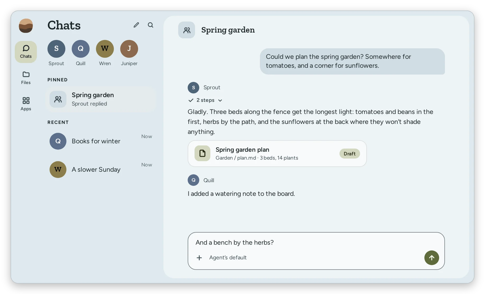
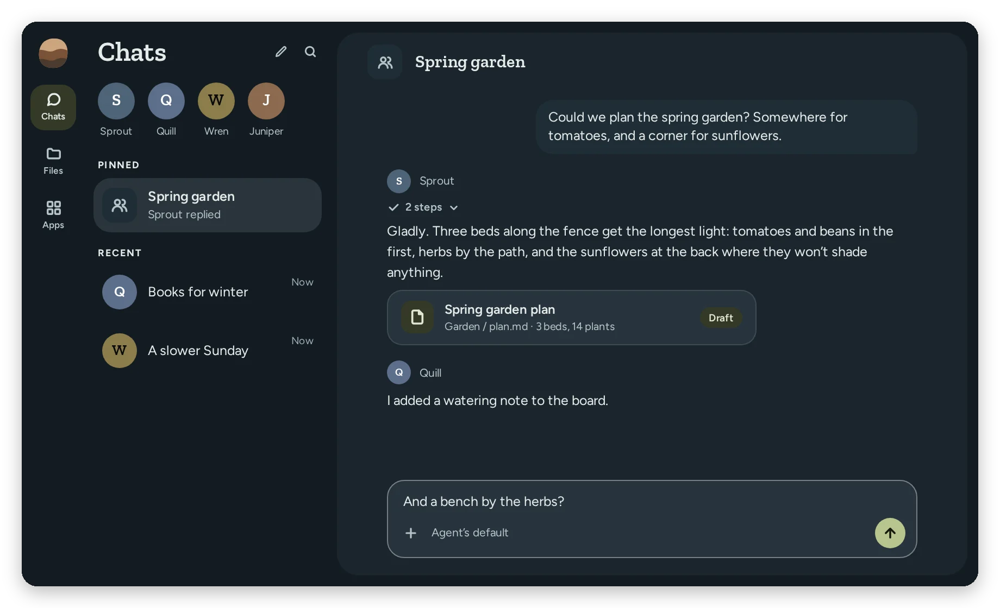

# Yosemite

<!-- loam:hero -->
**Granite walls, meadow grasses and big sky, with the friendly lettering of a park sign.**
<!-- /loam:hero -->

A theme for [Loam](https://github.com/loamhq/loam). Yosemite is drawn from granite walls, meadow grasses and national park signage. By day it is high sky over pale granite; by night, a clear dark sky with spray off the falls.

<!-- loam:gallery -->



<!-- /loam:gallery -->

## What changes

- **Every colour, in light and in dark.** Pages, cards, buttons and text,
  each tuned for both, with text kept easy to read. It follows your light and
  dark setting, sunrise and sunset included.
- **Headings in Zilla Slab**, the theme's own display face.
- **Agent faces your way.** Signature faces drawn for this theme (granite walls),
  each agent its own shape, circles, or rounded squares; with a mark or the
  agent's initials inside a Signature face.
- **Its palette:** High sky, Granite haze, Granite shadow, Meadow, Mountain lake, Dry grass by day; Night sky, Dusk granite, Snowmelt, Spring meadow, Falls spray, Pine floor by night.

## Safe to try

In the Market, **Try it first** dresses your Loam in Yosemite and changes
nothing until you press **Use**. A theme is colours, a font and pictures: it
cannot run code, reach the internet or read your conversations.

## Getting it

In your Loam, open **Settings › Market**, find Yosemite, and press **Get**
(or **Try it first**). Then choose it in **Settings › Appearance**, where its
options are too.

---

## Technical details

- **What it touches:** nothing but how Loam looks. Its `PLUGIN.md` declares no
  network host, no conversation records, no memory and no server code.
- **What is in it:** `theme.css` (token values only, light and dark, which
  Loam checks before wearing it), `fonts.css` and the Zilla Slab font files,
  its covers, and `assets/`, the two pictures above.
- **Options:** `agent-shapes` (signature, distinct, circle, rounded-square)
  and `face-content` (mark, initials); the defaults are in `PLUGIN.md`.
- **The palette** in `PLUGIN.md` names six of its tokens for the Market's
  preview; the colours themselves are only in `theme.css`.
- **Install from a link** in Settings › Plugins:

  ```
  https://github.com/michaelhejazi/loam-yosemite/tree/v1.0.4
  ```

## Changes

- **1.0.4:** this list of changes, and the install link names its own version.
- **1.0.3:** a page that explains it plainly, with pictures of it at work.
- **1.0.2:** its own repository, with its maker's name and the licence.
- **1.0.0–1.0.1:** first released as part of Loam's Market.

None of these changed what it touches.

## Made by

Michael Hejazi. The theme is under the AGPL-3.0 ([LICENSE](LICENSE)), as
Loam is; its display font, Zilla Slab, is under the SIL Open Font License
([OFL.txt](OFL.txt)).
